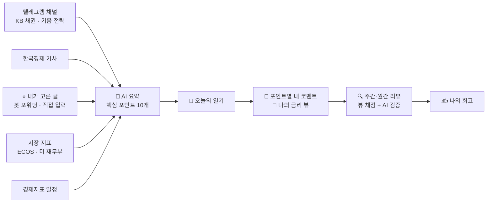

# 📒 Macro & Bond Journal — 매크로·채권 일기

매일 국내외 **매크로·채권시장 동향을 정리하고, 그 위에 나의 코멘트와 금리 뷰를 기록**하는 투자 일지입니다.
기록한 뷰는 주간·월간 단위로 **실제 금리 변화와 비교해 채점**하고, AI 검증 세션으로 근거를 되돌아봅니다.

<!-- AUTO-START -->
**기록 1일 · 코멘트 작성 0일 · 뷰 적중률 아직 채점된 뷰가 없습니다.**

### 🗓️ 최근 일기
- ·· [2026-11-25 (수)](journal/2026/11/2026-11-25.md) — 금통위 D-1 경계감에 국고 단기물은 약세, 장기물은 강보합으로 커브 플래트닝 진행. 코스피 6%대 급락과 미 AI주 쇼크 속 오늘 밤 미 PCE·GDP가 다음 변수

[→ 전체 목록](journal/INDEX.md)

### 🔍 최근 리뷰
- 아직 리뷰가 없습니다.
<!-- AUTO-END -->

---

## 하루의 흐름



| 시점 | 자동으로 일어나는 일 | 내가 하는 일 |
|---|---|---|
| 평일 10:00 | 지표·일정·핵심 포인트 정리 → 텔레그램 알림 | 포인트별 코멘트, 오늘의 뷰·총평 |
| 주말 16:00 | 다음 주 이벤트 위주 정리 | 다음 주 시나리오 코멘트 |
| 수시 | (3시간마다) 봇으로 보낸 글 요약·저장 | 중요한 글을 봇에 포워딩 |
| 일요일 17:00 | 주간 리뷰: 기간이 끝난 뷰 자동 채점 + AI 검증 | 회고 작성 |
| 매월 1일 | 월간 리뷰: 한 달 적중률·판단 습관 분석 | 회고 작성 |

## 일기 구성

1. **시장 지표** — 국고채 만기별(1Y~50Y)·통안·CD 금리와 전일비(bp), 회사채 AA-/BBB-, 미국채, 원/달러, 유가
2. **주요 스프레드** — 국고 10Y-3Y, 30Y-10Y, 국고 3Y-기준금리, 크레딧(AA-/BBB-), 한미 10Y, 미국채 10Y-2Y
3. **경제지표 일정** — 오늘부터 7일 (금통위, 미국 주요 지표 등)
4. **핵심 포인트** — 채권시장 / 금리 / 크레딧 / 한국 / 미국 / FX / 이벤트, 포인트마다 출처 링크와 💬 코멘트 칸
5. **나의 뷰** — 국고 3Y·10Y 방향, 커브, 기간, 확신도, 근거 → 리뷰에서 자동 채점

## 뷰 채점 방식

- 기준값: 일기를 쓰기 전 영업일 종가 → 비교값: 뷰 기간(1주/1개월)이 끝난 날 종가
- **강세** = 금리가 5bp 넘게 하락, **약세** = 5bp 넘게 상승, **중립** = ±5bp 이내 (커브는 10Y-3Y 스프레드 기준)
- 채점 결과는 [`data/view_scorecard.csv`](data/view_scorecard.csv)에 누적됩니다

## 데이터 출처

| 항목 | 출처 |
|---|---|
| 국고채·통안·CD·회사채 금리, 기준금리, 원/달러 | 한국은행 ECOS Open API |
| 미국채 금리 | U.S. Department of the Treasury, Daily Treasury Par Yield Curve |
| 미국 IG 회사채 OAS | FRED (ICE BofA US Corporate Index OAS) |
| WTI·브렌트 | Yahoo Finance (실패 시 FRED) |
| 해외 경제지표 일정 | Forex Factory 주간 캘린더 |
| 뉴스·리서치 | 한국경제 RSS, 공개 텔레그램 채널 |

> 뉴스·리서치 원문은 저장하지 않습니다. 기록에는 **AI 요약과 원문 링크만** 남깁니다.

## 폴더 구조

```
journal/YYYY/MM/YYYY-MM-DD.md   매일 일기
reviews/weekly/  reviews/monthly/   주간·월간 리뷰
inbox/                           ⭐ 내가 고른 글 (요약)
data/market.csv                  지표 시계열 (매일 누적)
data/view_scorecard.csv          뷰 채점 기록
data/events_kr.yaml              국내 일정 (직접 추가)
scripts/                         수집·요약·리뷰 코드 (Python)
pc/                              PC용 실행 파일 (더블클릭)
config.yaml                      채널·분류·분량 설정
```

설정과 사용법은 [SETUP.md](SETUP.md)를 보세요.
